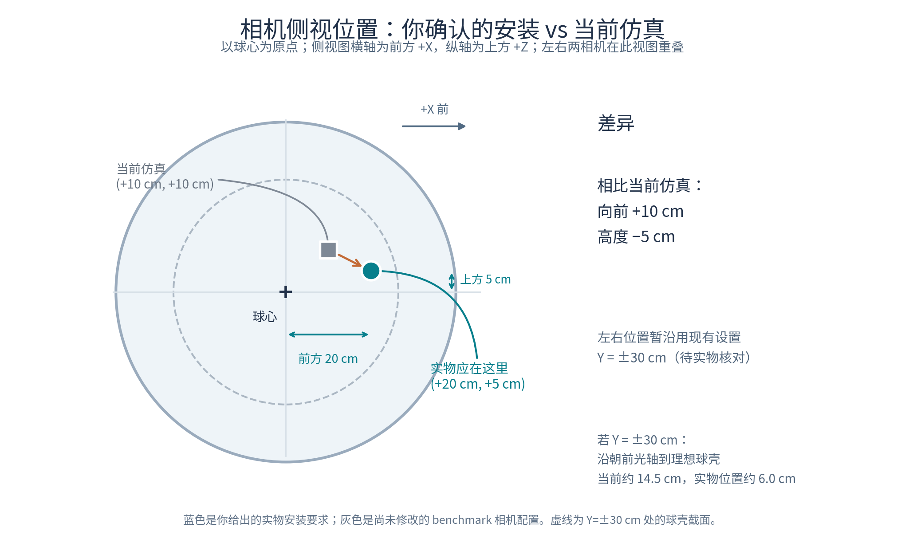
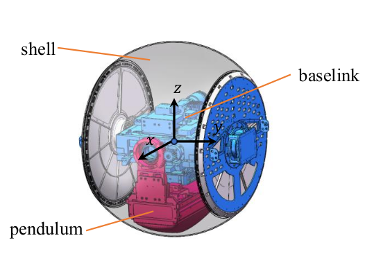
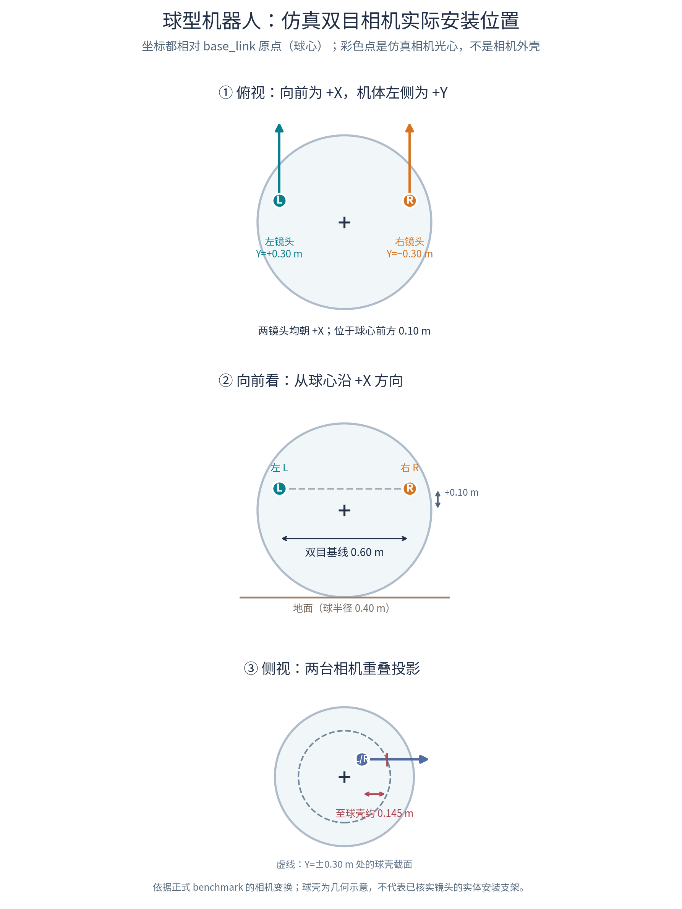
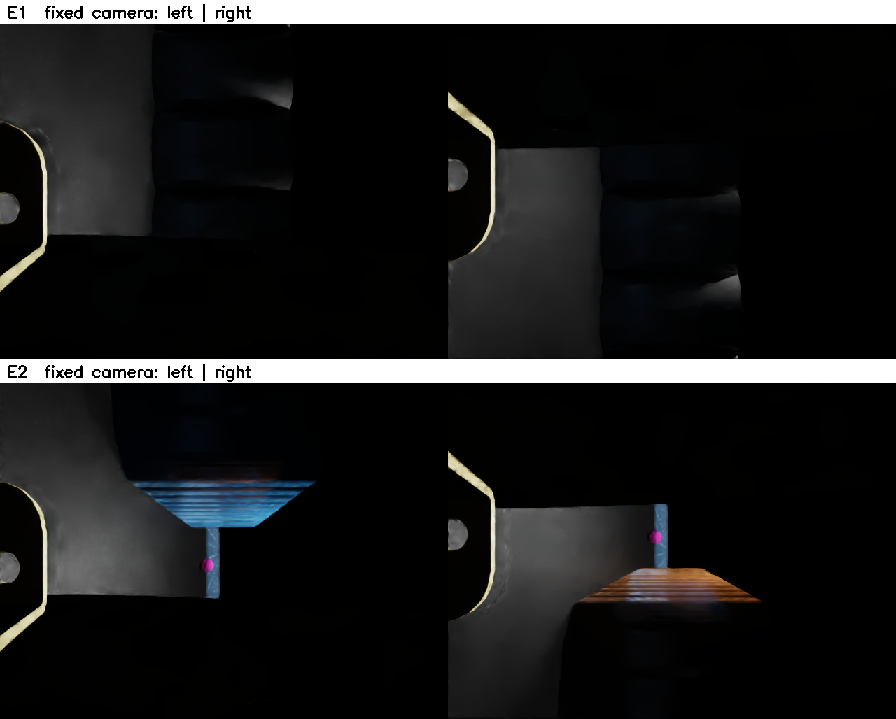
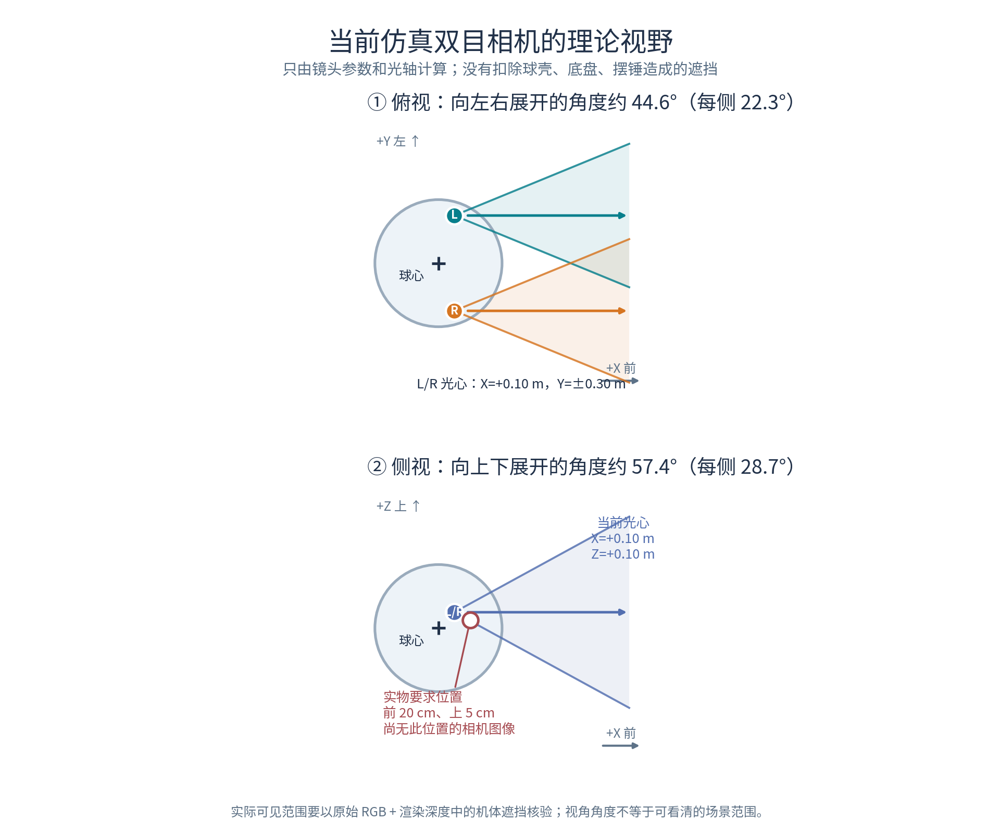
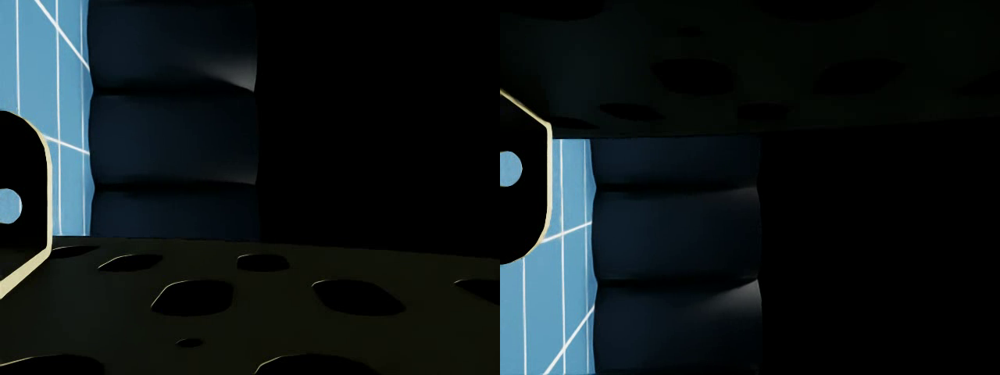
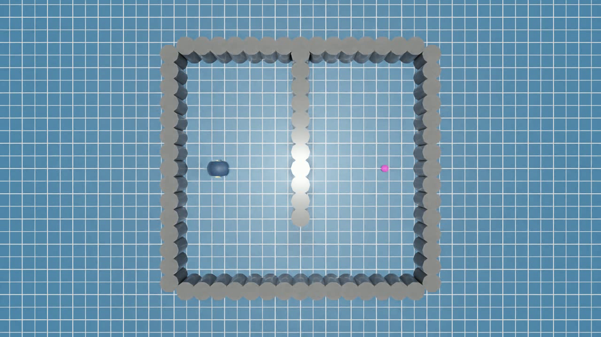
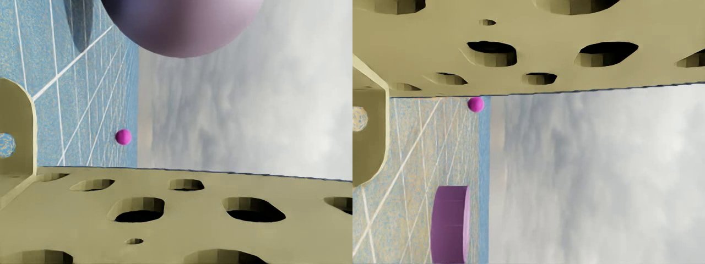
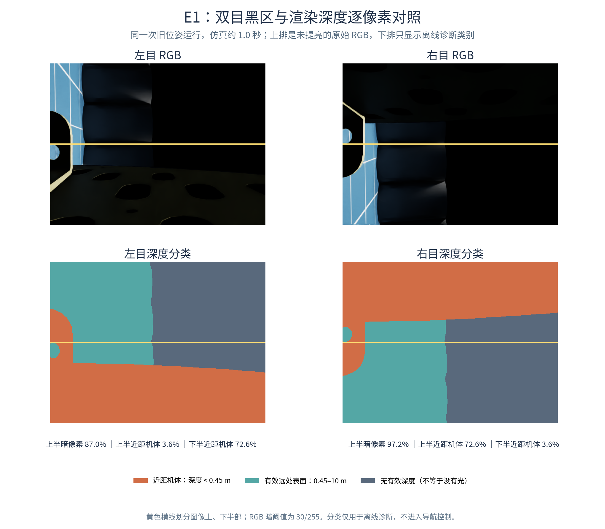

> **2026-10-08 更新：** 本文主体保留2026-09-30历史记录。当前相机X=0.20、Y=±0.30、Z=0.05米；最新条件到达、原E1失败与世界模型拒绝请先读[最新研究进展](2026-10-08_研究进展更新/研究进展与下一步.md)。历史成功率不能当作当前视觉成绩。

# 仿真相机安装位置核验

**本阶段已确认的实验选择：先沿用当前仿真相机位置**——左/右分别为球心坐标 `(X,Y,Z)=(+0.10,+0.30,+0.10)` m 和 `(+0.10,−0.30,+0.10)` m。用户此前指出侧视的实物期望为**前方 20 cm、上方 5 cm**，即 X=+0.20 m、Z=+0.05 m；这项差异保留作结构核对记录，本阶段**不改变 benchmark 相机位姿**，旧图像、历史结果和后续原位视觉实验都按当前坐标理解。

左右 Y 位置用户本次未修正；图中暂沿用仿真的 Y=±0.30 m 进行球壳截面示意，**不能据此确认实物左右间距**。如果实物的 Y 也不同，需要另行更新双目基线与完整相机外参。

下图画的是**当前正式导航 benchmark 使用的虚拟相机光心**，而非实体相机外壳或安装支架。球壳画为半径 0.40 m 的几何轮廓，保留作为旧仿真位置的记录。

用户提供的机器人结构图中，透明球壳包围 `base_link` 与内部摆锤；坐标原点在球心。该图没有标出镜头实体。

| 位置口径 | X（前） | Y（左） | Z（上） | 光轴 |
|---|---:|---:|---:|---|
| 当前仿真左目 | +0.10 m | +0.30 m | +0.10 m | 近似 +X |
| 当前仿真右目 | +0.10 m | −0.30 m | +0.10 m | 近似 +X |
| 实物应有的侧视位置（两目） | **+0.20 m** | **待核对** | **+0.05 m** | 待核对 |

当前仿真两光心间距 0.60 m。当前光心距理想球壳表面的最短径向距离约 0.068 m；沿正前方光轴到理想球壳的距离约 0.145 m。若**暂假定**实物 Y 仍为 ±0.30 m，则修正后的 X/Z 位置沿正前方至理想球壳仅约 0.060 m。这些距离只考虑球体轮廓，没有计入内部的 `base_link`、摆锤、支架和光路遮挡。

**可能让人觉得“不对”的两点：**

1. 两相机左右分开，但原始图像的画面向右近似对应机体 **+Z**，画面向下近似对应机体 **−Y**。因此这个相机姿态相当于常见直立画面旋转了约 90°，双目视差主要出现在图像竖向。若实物镜头的图像向右应是机体侧向，则仿真姿态需要核对。
2. 原位采集首帧显示大量机体结构进入视野。图中圆点只表示虚拟光心；仅凭几何坐标无法确认它是否处在实物的透明窗口、遮挡物之后，或是否与真实安装支架重合。

坐标口径必须区分：旧视觉报告通过相机世界 pose 减去 `Articulation.get_world_pose()` 的 root 位姿，推算出相对 root 的高度约 **0.063 m**。但采集序列封存的 `left_optical_to_base_extrinsic` 和 `right_optical_to_base_extrinsic` 直接给出的相对 `base_link` 高度都是 **0.100 m**，与正式 benchmark 的相机局部变换一致。由此可以确定旧反算使用的 root pose 不能直接当成图中的相机父节点局部原点；目前不能把 0.063 m 当成镜头装低了的证据。历史报告保留其原始计算，本页独立说明不同口径。

图与表的依据：正式运行的 `research/ball_wm/benchmark/isaac_runtime.py` 相机创建段；旧采集的 `research/ball_wm/scripts/collect_data_dubins.py` 相机创建段；`research/ball_wm/data/wm_aux30_calibration_20260926_v1/easy_1/easy_1_cal_forward_exchange/ep0000/metadata.json` 中的相机到 `base_link` 外参；本包的 `原位双目_E1_E2_首帧.png` 与原始报告 `benchmark_stereo_vertical_local_baseline_20260929.md`。

核对实物时，最关键的是在同一个球心坐标系中量出左右镜头光心的 X/Y/Z，确认镜头是否都朝向机体 +X，以及照片的右边/下边分别对应哪个机体方向。

## 当前仿真的图像、理论视野与光照

**以下画面全部来自尚未改动相机位置的旧仿真**，光心仍为 X=+0.10 m、Y=±0.30 m、Z=+0.10 m；不能当作用户要求的 X=+0.20 m、Z=+0.05 m 位置的渲染效果。

正式相机参数是焦距 16.45 mm、水平光圈 18.0 mm、640×480 像素，按画幅比例得到垂直光圈 13.5 mm。图像水平视角约 57.4°、垂直视角约 44.6°。由于现有相机画面横轴对应机体 +Z，**机体上下方向**对应约 57.4°；机体左右方向对应约 44.6°。这只是无遮挡的理论视锥，不是实际看得清的区域。

同一 E1 运行约 2 秒时的实际双目视频抽帧与外部视角如下；前者很暗，后者显示场景整体有光。另一条 E0 运行约 8 秒时，双目画面也可以明显变亮。三张图都是未经提亮的原视频帧。

这不支持“整个场景没有光源”的判断。正式 benchmark 运行时会移除上下两盏盘灯，只创建一盏强度为 1000 的平行光；旧数据采集入口则另外创建过上下盘灯。与此同时，旧深度审计在原位首帧把约 38.1% 像素判为 0.45 m 内近距自体。**推断：**机体内部阴影、机体遮挡、材质和光照方向共同造成暗画面；仅提亮已录视频无法恢复被遮住的场景，也不能证明增加灯光一定解决视觉导航。下一项补光对照应固定本阶段选定的原位相机、场景和姿态；先前讨论的 20 cm／5 cm 位置不混入这一对照。

### 上半部黑区的进一步核验

对旧安装、同一 E1 场景另一条带渲染深度记录的约 1.0 秒样本，把每个像素分成近距机体（`<0.45 m`）、有效远处表面（`0.45–10 m`）和无有效深度三类。**这不是用户截图约 2 秒那一帧**，但相机位置相同，能检验遮挡在左右目和上下半图如何分布。下图上排是原始 RGB，下排是离线深度分类；黄色横线是半图边界。

| E1 约 1 秒 | 上半部暗像素，亮度 `<30/255` | 上半部近距机体 | 下半部近距机体 |
|---|---:|---:|---:|
| 左目 | 87.0% | **3.6%** | **72.6%** |
| 右目 | 97.2% | **72.6%** | **3.6%** |

结论是**两目上半部黑的原因不一样**：右目上半部大面积有近距机体遮挡，补光无法让它看穿机体；左目近距机体主要在下半部，其上半部黑区还混有暗的远处表面与无有效深度区域，不能笼统说成全是遮挡或全是灯光不足。无有效深度也不等于没有光源。今后在冻结相机位置下改善画面，应分别检查遮挡区域、有效场景区域的亮度/曝光和补光效果，保留相同姿态及场景作对照。

**“无有效深度”是否也是机体遮挡？**在上述 E1 约 1 秒样本中，左/右两目的无效深度值全部为 `+∞`，表示深度标注器没有报告可测的表面；它和明确测得 `<0.45 m` 的近距机体是两类数据。左目上半部约 **52.7%** 是这类无效深度，但近距机体仅 **3.6%**。对照相同相机位置的 E0 约 1 秒样本，左目上半部约 **59.0%** 也是无效深度，而这些无效像素的 RGB 亮度均超过 60/255。因此不能把无效深度直接判成“机体挡住”或“没有光”；更可能包含没有击中深度标注器可测表面的背景等情形。具体对应哪个 USD 物体或透明表面，现有 RGB/深度记录尚不能逐像素证明，需另做语义或几何射线核验。
