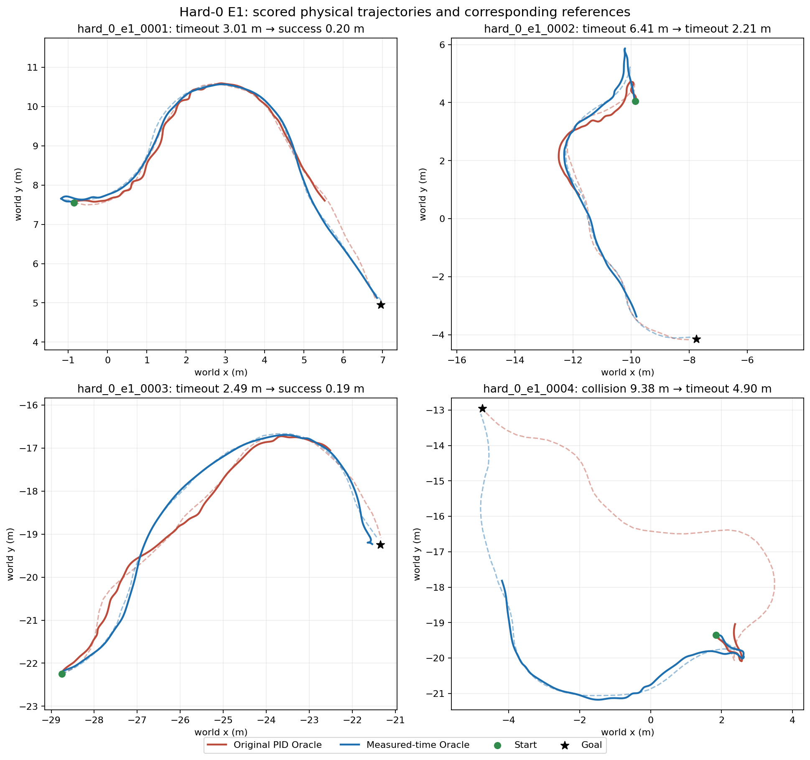

> **2026-10-08 更新：** 本文主体保留2026-09-30历史记录。当前相机X=0.20、Y=±0.30、Z=0.05米；最新条件到达、原E1失败与世界模型拒绝请先读[最新研究进展](2026-10-08_研究进展更新/研究进展与下一步.md)。历史成功率不能当作当前视觉成绩。

# 球型机器人导航：研究进展与世界模型学习包

整理日期：2026-09-30。给新加入项目的同学阅读。本文件夹聚焦**研究目标、已经做过的实验、真实结果、尚未解决的问题和世界模型学习路径**；不包含源码、运行命令或复现教程。

## 建议阅读顺序

1. [研究进展与实测结果](01_项目现状与实测结果.md)：先分清 Oracle、传统视觉和世界模型各自完成到什么程度。
2. [世界模型学习指南](02_世界模型学习指南.md)：从概念、论文和研究问题逐步学习。
3. [世界模型项目 GitHub 索引](04_世界模型项目GitHub索引.md)：打开作者公开的项目仓库与演示页。
4. [后续研究路线](03_后续研究路线.md)：看下一步要验证的假设和标准。
5. [相机安装、视野与光照核验](05_相机安装位置核验.md)：看实物与仿真位置的差异、当前双目画面及暗画面证据。
6. [原始报告](原始报告/)和[结果图](结果图/)：需要追溯数字时再读。

## 目前的核心结论

| 研究线 | 已有结果 | 当前判断 |
|---|---|---|
| 地图与真值定位的 Oracle | 独立实验候选在已知 35 秒测试中，golden E0/E1/E2 **3/3**、hard_0 **5/7** | 已有可参考的导航上界；hard_0 另两条仍超时，且该候选未替换默认版本。 |
| 固定原位双目视觉 | 传统视觉局部候选在 golden **1/3** | 能在线使用图像，但目前会漏避障或误判可通走廊，还不是合格视觉基线。 |
| 世界模型 | 旧动作协议的模型闭环 golden **0/3**；新协议下短时运动预测有部分离线改善 | 新候选尚未通过接入导航的验收，不能宣称世界模型导航成功。 |

这些数字来自不同输入权限和部分不同协议，**不能直接当作同一赛道的排名**。Oracle 可用地图/真值；视觉和世界模型的在线判断不能读取未来状态或仿真真值标签。golden 与 hard_0 已用于研发，不是全新盲测集。

## 三条边界，交接时先讲清

- **成功定义**：正式导航每条最多 35 秒，首次进入目标 0.2 m 内算成功；这不等于到达后稳定停车。2026-09-29 后的默认碰撞判定是过滤地面后的实际障碍接触，不能与旧地图净空失败混成同一成功率。
- **输入权限**：Oracle 可用地图/真值位姿，是规划与控制能力的上界对照；视觉和世界模型的部署输入只能使用当时可得的图像、本体信息、目标和已知请求。渲染深度、完整地图、未来反馈只能作为离线标签/评分。
- **硬件约束**：双目相机位置固定，不能为了改成绩移动。图像中的机体遮挡与纵向视差是当前真实几何的一部分。

## 文件夹内容

| 文件/目录 | 用途 |
|---|---|
| `01_项目现状与实测结果.md` | 项目目标、已完成工作、数字、未解决问题 |
| `02_世界模型学习指南.md` | 概念路线、近两年新研究和经典论文、阅读问题 |
| `03_后续研究路线.md` | 可检验假设、实验优先级与验收标准 |
| `04_世界模型项目GitHub索引.md` | 经核对的作者 GitHub 仓库及项目演示入口；无源码副本 |
| `05_相机安装位置核验.md` | 实物与仿真位置、理论视野、原始双目画面和光照核验 |
| `原始报告/` | 10 份历史研究报告副本，用于追溯结论；内含部分当时的技术路径，阅读本包无需运行代码 |
| `结果图/` | 代表性轨迹、相机视野、预测误差图 |
| `论文PDF/` | 13 篇从 arXiv 官方页面下载的论文，包含 2025–2026 年的导航世界模型研究 |
| `SHA256SUMS.txt` | 资料文件的完整性校验值 |

本文件夹是一份**研究学习包**，不承担项目源码、原始数据、模型权重或视频的备份功能。
